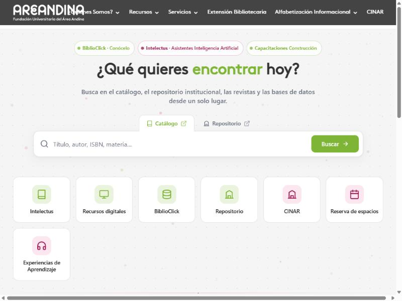
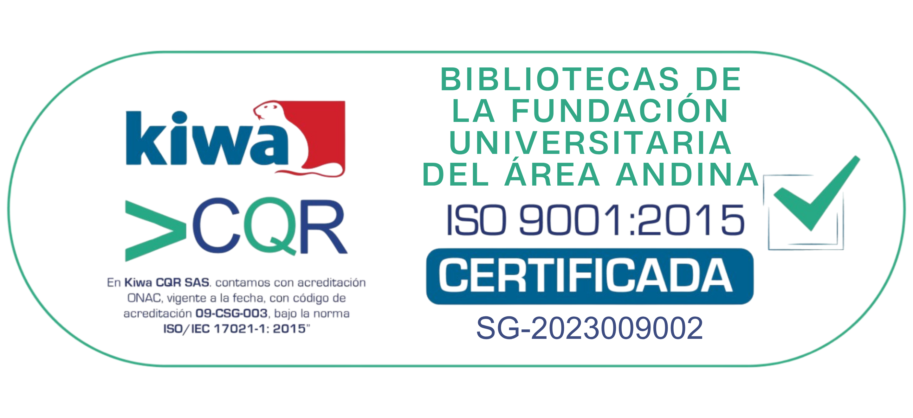

<h1 align="center">Bibliotecas Areandina</h1>

<em>Espacio institucional de código, guías y documentación de proyectos tecnológicos de las Bibliotecas de la Fundación Universitaria del Área Andina.</em>

  
  
  

## De la biblioteca digital a los proyectos

La [biblioteca digital](https://bidig.areandina.edu.co/) organiza sus servicios en accesos rápidos. Esta tabla indica con qué proyecto de este espacio se relaciona cada uno; es una orientación, no una prueba de integración.

| Acceso en la biblioteca digital | Proyecto relacionado |
|---|---|
| Intelectus (asistentes de IA) | [aulas-inteligentes-gems](https://github.com/BIBLIOTECAS-AREANDINA/aulas-inteligentes-gems), [chatbot](https://github.com/BIBLIOTECAS-AREANDINA/chatbot) |
| Repositorio (Digitk) | [digitk-cargue-repositorio](https://github.com/BIBLIOTECAS-AREANDINA/digitk-cargue-repositorio), [Digitek_sistema_repositorio](https://github.com/BIBLIOTECAS-AREANDINA/Digitek_sistema_repositorio) |
| CINAR e indicadores | [BibliometriX](https://github.com/BIBLIOTECAS-AREANDINA/BibliometriX), [Generador-ndice-H](https://github.com/BIBLIOTECAS-AREANDINA/Generador-ndice-H), [AnalisisCuant](https://github.com/BIBLIOTECAS-AREANDINA/AnalisisCuant) |
| Acuerdos interbibliotecarios | [reunir-ill-system](https://github.com/BIBLIOTECAS-AREANDINA/reunir-ill-system) |
| Alfabetización informacional | [Ruta-informacional-](https://github.com/BIBLIOTECAS-AREANDINA/Ruta-informacional-), [Seleciones-con-sentido](https://github.com/BIBLIOTECAS-AREANDINA/Seleciones-con-sentido) |

## Sitios en vivo (GitHub Pages)

Las direcciones antiguas `rekol08.github.io/...` ya no funcionan; usar estas. Un sitio que responde no equivale a una prueba funcional completa.

| Sitio | Dirección |
|---|---|
| BiblioNova (tablero) | [bibliotecas-areandina.github.io/BIBLIONOVA](https://bibliotecas-areandina.github.io/BIBLIONOVA/) |
| BibliometriX | [bibliotecas-areandina.github.io/BibliometriX](https://bibliotecas-areandina.github.io/BibliometriX/) |
| Generador de índice H | [bibliotecas-areandina.github.io/Generador-ndice-H](https://bibliotecas-areandina.github.io/Generador-ndice-H/) |
| AnalisisCuant | [bibliotecas-areandina.github.io/AnalisisCuant](https://bibliotecas-areandina.github.io/AnalisisCuant/) |
| Ruta informacional | [bibliotecas-areandina.github.io/Ruta-informacional-](https://bibliotecas-areandina.github.io/Ruta-informacional-/) |
| Aulas inteligentes (Gems) | [bibliotecas-areandina.github.io/aulas-inteligentes-gems](https://bibliotecas-areandina.github.io/aulas-inteligentes-gems/) |
| Préstamo interbibliotecario | [bibliotecas-areandina.github.io/reunir-ill-system](https://bibliotecas-areandina.github.io/reunir-ill-system/) |
| Digitk (variantes) | [bibliotecas-areandina.github.io/Digitek_sistema_repositorio](https://bibliotecas-areandina.github.io/Digitek_sistema_repositorio/) |
| Librín (solo frontend) | [bibliotecas-areandina.github.io/chatbot](https://bibliotecas-areandina.github.io/chatbot/) |

Sin Pages por diseño: `digitk-cargue-repositorio` y `Seleciones-con-sentido` son proyectos de Apps Script, y `koha-laboratorio` es privado.

## Punto de entrada

- [BiblioNova: tablero y documentación](https://github.com/BIBLIOTECAS-AREANDINA/BIBLIONOVA)
- [Tablero web](https://bibliotecas-areandina.github.io/BIBLIONOVA/)
- [Inventario y bitácora de centralización](https://github.com/BIBLIOTECAS-AREANDINA/BIBLIONOVA/blob/main/docs/CENTRALIZACION_2026-11-13.md)

## Proyectos públicos

- [BIBLIONOVA](https://github.com/BIBLIOTECAS-AREANDINA/BIBLIONOVA): Tablero de 12 proyectos y vínculo documental con CIBIC 2026; no identifica una VM CIBIC.
- [Generador-ndice-H](https://github.com/BIBLIOTECAS-AREANDINA/Generador-ndice-H): HTML/JS; Excel/CSV, índice h/g/i10; SheetJS y Chart.js por CDN. Validación con datos ficticios pendiente.
- [BibliometriX](https://github.com/BIBLIOTECAS-AREANDINA/BibliometriX): HTML/JS; Scopus/WoS y Chart.js; workflow Jekyll existente. Validación de indicadores pendiente.
- [AnalisisCuant](https://github.com/BIBLIOTECAS-AREANDINA/AnalisisCuant): HTML/JS; estadísticas y Chart.js. Revisar aproximaciones antes de uso académico formal.
- [digitk-cargue-repositorio](https://github.com/BIBLIOTECAS-AREANDINA/digitk-cargue-repositorio): Plantilla Apps Script con formulario y procesador; configuración productiva externa.
- [Digitek_sistema_repositorio](https://github.com/BIBLIOTECAS-AREANDINA/Digitek_sistema_repositorio): Variantes v1/v2 Apps Script de Digitk; comparar con digitk-cargue-repositorio antes de consolidar.
- [reunir-ill-system](https://github.com/BIBLIOTECAS-AREANDINA/reunir-ill-system): Apps Script para préstamo interbibliotecario y presentación web; producción declarada en README, no probada aquí.
- [Ruta-informacional-](https://github.com/BIBLIOTECAS-AREANDINA/Ruta-informacional-): Guía de ciencia abierta; HTML/JS, QRCode.js y recursos externos.
- [aulas-inteligentes-gems](https://github.com/BIBLIOTECAS-AREANDINA/aulas-inteligentes-gems): Instrucciones de 8 Gems y taller Areandina; no acredita creación o acceso a esos Gems.
- [chatbot](https://github.com/BIBLIOTECAS-AREANDINA/chatbot): Librín: Express, Groq y n8n local; Pages no ejecuta el backend. Pruebas de servicio pendientes.
- [Seleciones-con-sentido](https://github.com/BIBLIOTECAS-AREANDINA/Seleciones-con-sentido): Apps Script y panel bibliográfico sanitizados; falta vista Index según README. No desplegable completo todavía.

## Cómo colaborar

1. Revisar el README y las instrucciones del proyecto antes de editar. Registrar objetivo, alcance y evidencia.
2. Coordinar tareas en el plan institucional Innovación, depósito BIBLIONOVA; revisar lo existente para evitar duplicados.
3. Proponer cambios mediante ramas y pull requests, conservando autoría, licencias y decisiones humanas.
4. Verificar enlaces, dependencias y funcionamiento con datos ficticios antes de cerrar una tarea. Un HTTP 200 no acredita una prueba funcional completa.
5. Mantener credenciales, datos operativos, imágenes de VM, bases y respaldos fuera de repositorios públicos. Documentar su ubicación institucional y recuperación en los espacios con acceso adecuado.
6. No modificar Koha de producción como parte de pruebas o documentación. Coordinar cualquier trabajo de laboratorio con el responsable activo.

La documentación diferencia resultados comprobados, antecedentes y pendientes. Las responsabilidades deben resolverse con identidades verificadas; no se deducen cargos ni usuarios por similitud de nombres.

## Alianzas y reconocimientos

  
  
  
  

